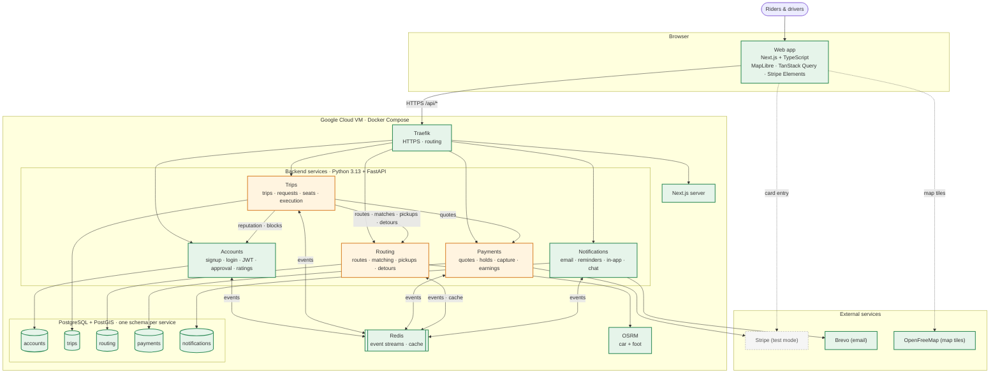
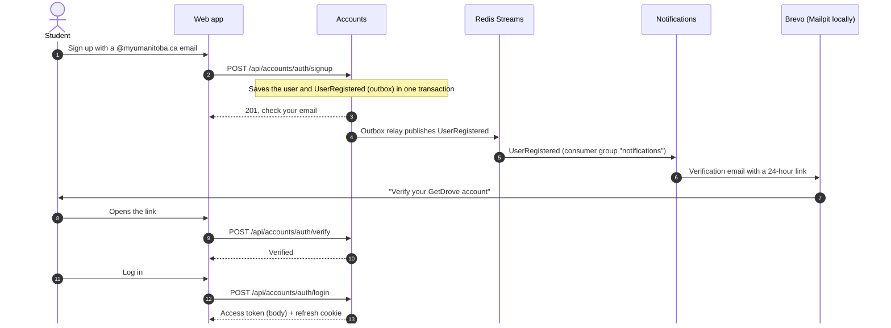
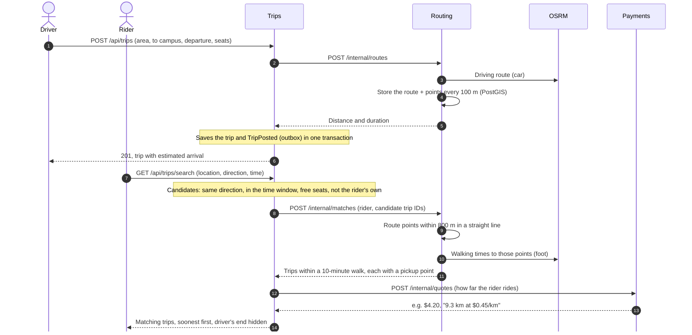
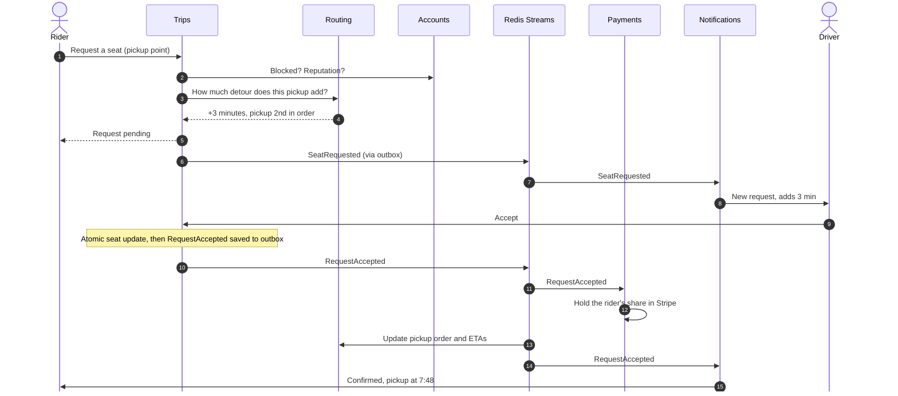

# Architecture

> Back to [README](../../README.md) · [Sprint 0](../../sprint0.md) · [Technology stack](tech-stack.md) · [Decision records](adr/README.md)

This page describes the major parts of GetDrove and how they interact. It shows the full design decided in Sprint 0, updated at the end of Sprint 1, and marks which parts are built so far ([Sprint 1 status](#sprint-1-status)). It's updated every sprint. A detailed, editable version of the diagrams is in [`getdrove-architecture.drawio`](getdrove-architecture.drawio) (open it with diagrams.net or the VS Code Draw.io Integration extension).

## Components

**Key:** green = built in Sprint 1 · orange = the Sprint 1 part is built, more comes in later sprints · grey dashed = later sprints. Each box lists everything the component will do, not only what's built; see [Sprint 1 status](#sprint-1-status).

| Component | Responsibility |
|---|---|
| **Web app** | Next.js + TypeScript client for riders and drivers. Mobile-first, responsive. Pages stay thin; logic lives in feature modules. |
| **Traefik** | The only public entry point. HTTPS via Let's Encrypt for https://getdrove.duckdns.org ([#110](https://github.com/Andrew-Ih/COMP-4350-Group5-GetDrove/issues/110)); routes `/api/<service>/*` to services and everything else to the Next.js server. No business or auth logic. |
| **Accounts** | Signup restricted to `@myumanitoba.ca`, email verification, login, JWT issuing (RS256) and the JWKS endpoint, driver documents and vehicle, admin approval, ratings, reputation, blocks, reports. |
| **Trips** | One-off and recurring trips, seat requests, eligibility rules, manual and automatic acceptance, atomic seat counting, trip execution (start, pickup, no-show, complete), share links. |
| **Routing** | Computes and stores driving routes (PostGIS), finds trips that pass near a rider by road-network distance, suggests pickup points, calculates detours with pickup ordering, and returns rider-safe route geometry (driver's start hidden). Uses OSRM. |
| **Payments** | Distance-based price quotes, rider card setup, holds on acceptance, capture after completion, release on cancellation, earnings ledger with simulated weekly settlement. Uses Stripe in test mode. |
| **Notifications** | In-app and email notifications, scheduled reminders, and trip group chat. The browser polls for new messages and notifications every few seconds. Uses Brevo for email in production and Mailpit locally. |
| **PostgreSQL + PostGIS** | One instance; each service has its own schema and database user, so services can't read each other's data. |
| **Redis** | Event streams between services and a cache for routing data. Runs with AOF persistence. |
| **OSRM** | Self-hosted routing engine with car and foot profiles, built from a Winnipeg map extract ([infra/osrm](../../infra/osrm/README.md)). |

## Communication boundaries

- **Browser to backend:** REST over HTTPS, always through Traefik. One origin, so no CORS in production. Trip chat and notifications are polled every 3–5 seconds while they're open; there are no WebSockets in the core design. Live driver tracking is a stretch goal ([ADR 0018](adr/0018-live-tracking-as-stretch-goal.md)).
- **Authentication:** Accounts issues short-lived JWTs (15 minutes). **Each service validates tokens itself** using Accounts' public key (JWKS). Traefik does no auth. The web app keeps the access token in memory and gets a new one with a refresh token in an `HttpOnly` cookie, which is swapped on every use ([ADR 0022](adr/0022-login-sessions.md)).
- **Synchronous calls between services:** REST over the private Docker network to `/internal/…` endpoints, which Traefik never exposes. Used when the caller needs an answer immediately (e.g. Trips asking Routing for a detour quote).
- **Asynchronous events:** published to **Redis Streams** through a **transactional outbox** (the event is saved in the same database transaction as the change, then relayed). Each consuming service reads with its own consumer group and processes events idempotently, so events survive restarts and duplicates are harmless.
- **Data ownership:** a service only reads and writes its own schema. Other services' data is reached only through APIs or events.
- **External services:** Stripe (payments), Brevo (email), and OpenFreeMap (map tiles, loaded directly by the browser). Card details go from the browser straight to Stripe and never touch our servers.

## Sprint 1 status

| Part | Status at the end of Sprint 1 |
|---|---|
| **Web app** | Built: signup, email verification, login (stays logged in across reloads, log out), rider home, search results with each trip's route, pickup point and cost on the map, and posting a trip, all against the real APIs. The mock API (`npm run dev:mock`) stays for building screens before their endpoints exist. |
| **Traefik** | Built: HTTPS for https://getdrove.duckdns.org with a Let's Encrypt certificate, http redirected to https ([#110](https://github.com/Andrew-Ih/COMP-4350-Group5-GetDrove/issues/110)); routes `/api/<service>/*` to the services and everything else to the web app, never exposes `/internal`. No access log, because request URLs hold riders' locations. |
| **Accounts** | Built: signup (UofM emails only), email verification and resend, login, refresh and logout with reuse detection, `GET /me`, JWKS. Driver approval, ratings and blocks come later. |
| **Notifications** | Built: consumes `UserRegistered` and `VerificationEmailRequested` and sends the verification email, handling each event once and parking ones that keep failing. |
| **Trips** | Built: posting a one-off trip (its route computed by Routing, `TripPosted` published through the outbox), the driver's upcoming trips (`GET /mine`), and search (time window and free seats, matching from Routing, costs from Payments, the driver's end hidden). Next: trip detail, seat requests, recurring trips, execution. |
| **Routing** | Built: computing and storing each trip's driving route (PostGIS), points every 100 m along it, matching a rider to the trips they can walk to (straight-line corridor, then real walking times), a private pickup point (never near either end of the route), and the route for the map. Next: detours and pickup ordering. |
| **Payments** | Built: the internal price quote ($0.45/km, nearest 5¢, $2.00 minimum, from settings) with a one-line explanation. Next: card setup, holds and capture with Stripe. |
| **OSRM** | Built: car and foot instances with the Winnipeg map built into their images, locally and on the live server, logging no request URLs ([#23](https://github.com/Andrew-Ih/COMP-4350-Group5-GetDrove/issues/23), [#233](https://github.com/Andrew-Ih/COMP-4350-Group5-GetDrove/issues/233)). |
| **PostgreSQL, Redis** | Built: one schema and user per service, migrations run on start; the outbox and Redis Streams carry the Accounts and Trips events. |
| **Deployment** | Built: merging to `main` builds the images (including OSRM) in GitHub Actions, deploys them to the VM, checks OSRM answers a real route, and runs a smoke test over HTTPS. Real emails go out through Brevo. |

## Flow built in Sprint 1: signing up and verifying an email

This is the first flow that crosses services, and it runs end to end today.

If Notifications is down, `UserRegistered` waits in the stream and the email goes out when it's back. Asking for a new link publishes `VerificationEmailRequested`, which takes the same path.

## Flow built in Sprint 1: a driver posts a trip and a rider finds it

The core of route matching: riders only see trips whose real driving route passes within walking distance, and they never see where the driver starts.

If Routing or OSRM is down, posting returns 503 and nothing is saved, and search returns 503. If Payments is down, search still shows the trips, without a cost. The rider's location is used for matching only, never stored or logged.

## Example flow (planned): a rider requests a seat and the driver accepts

## Deployment

Everything runs as Docker containers on one **Google Cloud Compute Engine VM** (e2-standard-2, Ubuntu 24.04, Toronto region), started with Docker Compose. Every pull request into `develop` or `main` runs the tests in GitHub Actions. Every merge to `main` (a release or hotfix) builds `linux/amd64` images, pushes them to GitHub Container Registry, deploys them to the live site and runs a smoke test. Planned: building images on every merge to `develop` ([#176](https://github.com/Andrew-Ih/COMP-4350-Group5-GetDrove/issues/176)) and publishing versioned images to DockerHub on release tags ([#189](https://github.com/Andrew-Ih/COMP-4350-Group5-GetDrove/issues/189)). The same Compose setup runs the whole system locally with one command. See [ADR 0016](adr/0016-google-cloud-hosting-and-deploy-from-main.md) and the [server setup guide](../deployment/server-setup.md).

## How the design supports our non-functional expectations

- **Routing is isolated** because it's the most expensive service and the main scalability bottleneck. It can be load-tested and optimized on its own, and if it's down, accepted trips are unaffected.
- **Notifications is decoupled through events**, so trips keep running if it's down; events wait in Redis and are delivered once it recovers.
- **One schema per service** keeps data ownership clear and stops services depending on each other's internals.
- **The outbox and idempotent consumers** mean no event is lost or applied twice.

See [non-functional expectations](../product/non-functional.md).
