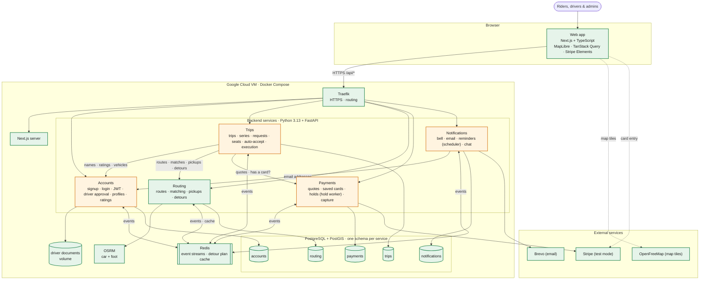
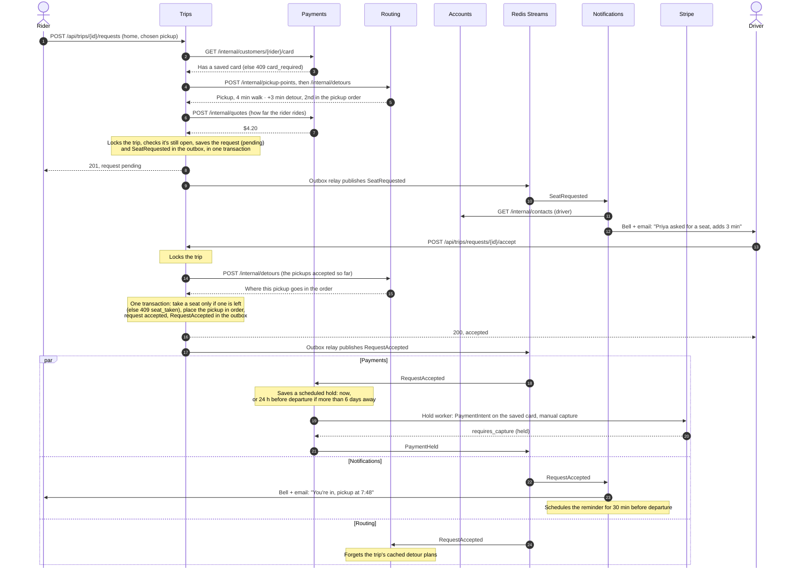
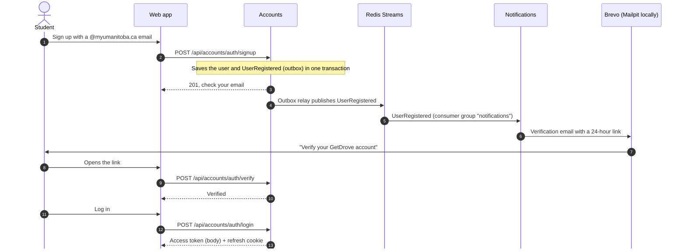
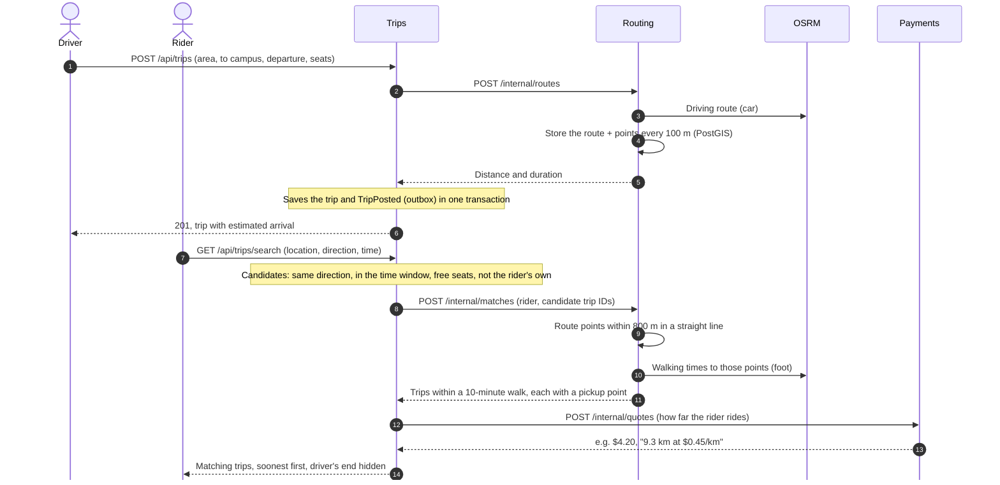
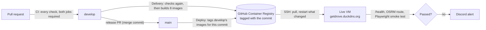

# Architecture

> Back to [README](../../README.md) · [Sprint 0](../../sprint0.md) · [Technology stack](tech-stack.md) · [Decision records](adr/README.md)

This page describes the major parts of GetDrove and how they interact. It shows the full design decided in Sprint 0, updated at the end of Sprint 2, and marks which parts are built so far ([Sprint 2 status](#sprint-2-status)). It's updated every sprint. A detailed, editable version of the diagrams is in [`getdrove-architecture.drawio`](getdrove-architecture.drawio) (open it with diagrams.net or the VS Code Draw.io Integration extension).

## Components

**Key:** green = built · orange = built for what Sprint 2 needs, more comes in Sprint 3 · grey dashed = later. Each box lists everything the component will do, not only what's built; see [Sprint 2 status](#sprint-2-status).

| Component | Responsibility |
|---|---|
| **Web app** | Next.js + TypeScript client for riders, drivers and admins. Mobile-first, responsive. Pages stay thin; logic lives in feature modules. Card details are typed into Stripe Elements and go straight to Stripe. |
| **Traefik** | The only public entry point. HTTPS via Let's Encrypt for https://getdrove.duckdns.org; routes `/api/<service>/*` to services and everything else to the Next.js server. No business or auth logic, and no access log (request URLs hold riders' locations). |
| **Accounts** | Signup restricted to `@myumanitoba.ca`, email verification, login, JWT issuing (RS256) and the JWKS endpoint, driver documents (stored on a Docker volume) and vehicle, admin approval, public profiles and reputation. Later: writing ratings, blocks, reports, the late-cancellation record. |
| **Trips** | One-off and recurring trips, seat requests, eligibility rules (including a saved card), manual and automatic acceptance, seat counting that can't oversell, cancellations, a copy of who's an approved driver. Later: trip execution (start, pickup, no-show, complete), share links. |
| **Routing** | Computes and stores driving routes (PostGIS), finds trips that pass within walking distance of a rider, suggests pickup points, calculates detours and the pickup order, and returns rider-safe route geometry (driver's start hidden). Caches detour plans in Redis and forgets a trip's plans when its riders change. Uses OSRM. |
| **Payments** | Distance-based price quotes, saved cards (Stripe customers and SetupIntents), holds on the rider's card after acceptance (placed and released by a background **hold worker**), releasing holds on cancellation. Later: capture after the trip, no-show charges, earnings ledger. Uses Stripe in test mode. |
| **Notifications** | The in-app bell and an email for each request and trip update, the verification email, and ride reminders 30 minutes before departure (a background **reminder scheduler**). The browser polls the bell. Later: trip group chat. Uses Brevo for email in production and Mailpit locally. |
| **PostgreSQL + PostGIS** | One instance; each service has its own schema and database user, so services can't read each other's data. |
| **Redis** | Event streams between services and Routing's detour plan cache. Runs with AOF persistence. |
| **OSRM** | Self-hosted routing engine with car and foot profiles, built from a Winnipeg map extract ([infra/osrm](../../infra/osrm/README.md)). |

## Communication boundaries

- **Browser to backend:** REST over HTTPS, always through Traefik. One origin, so no CORS in production. The bell is polled while the app is open; there are no WebSockets in the core design. Live driver tracking is a stretch goal ([ADR 0018](adr/0018-live-tracking-as-stretch-goal.md)).
- **Authentication:** Accounts issues short-lived JWTs (15 minutes). **Each service validates tokens itself** using Accounts' public key (JWKS). Traefik does no auth. The web app keeps the access token in memory and gets a new one with a refresh token in an `HttpOnly` cookie, which is swapped on every use ([ADR 0022](adr/0022-login-sessions.md)). Admin pages need the `admin` role in the token.
- **Synchronous calls between services:** REST over the private Docker network to `/internal/…` endpoints, which Traefik never exposes. Used only when the caller needs an answer to carry on (table below). Each call has a timeout. If the other service is down, the caller either answers `503` with a clear code and saves nothing (posting, requesting a seat), or carries on without the optional part (search without a cost).
- **Asynchronous events:** published to **Redis Streams** through a **transactional outbox** (the event is saved in the same database transaction as the change, then relayed). Each consuming service reads with its own consumer group and records every event it handles in `processed_events` in the same transaction as its change, so a repeat delivery changes nothing twice. An event that keeps failing is parked after 5 tries.
- **Data ownership:** a service only reads and writes its own schema. Other services' data is reached only through APIs or events. When a service needs another's data on every request, it keeps its own copy from events instead of calling: Trips' list of approved drivers ([ADR 0023](adr/0023-approved-drivers-read-model.md)).
- **External services:** Stripe (payments), Brevo (email), and OpenFreeMap (map tiles, loaded directly by the browser). Card details go from the browser straight to Stripe and never touch our servers; Payments only keeps Stripe's customer and payment method IDs.

### Calls between services

| Caller → service | Endpoint | Why it can't be an event |
|---|---|---|
| Trips → Routing | `POST /internal/routes`, `/matches`, `/pickup-points`, `/detours` | Posting, search and requesting a seat need the route, the matches, the pickup and the detour to answer the user |
| Trips → Payments | `POST /internal/quotes` | The cost is shown in search and on the request |
| Trips → Payments | `GET /internal/customers/{id}/card` | A rider must have a saved card before asking for a seat (`409 card_required`) |
| Trips → Accounts | `GET /internal/users` | Riders' names and ratings for the driver's request list and auto-accept; the driver's name and vehicle for the trip detail |
| Notifications → Accounts | `GET /internal/contacts` | Where to send each email. Notifications never stores email addresses. |

### Events

| Event | Published by | Consumed by |
|---|---|---|
| `UserRegistered`, `VerificationEmailRequested` | Accounts | Notifications (verification email) |
| `DriverApproved`, `DriverRejected` | Accounts | Trips (its approved-driver list), Notifications |
| `TripPosted` | Trips | — (for Sprint 3 consumers) |
| `SeatRequested` | Trips | Notifications (tells the driver) |
| `RequestAccepted` | Trips | Payments (schedules the hold), Notifications (tells the rider, schedules the reminder), Routing (forgets cached plans) |
| `RequestDeclined`, `RequestCancelled` | Trips | Payments (releases the hold), Notifications, Routing |
| `TripCancelled` | Trips | Payments (releases every hold on the trip), Notifications (tells the riders, cancels reminders), Routing |
| `DriverLateCancellation` | Trips | Accounts' reliability record (Sprint 3, #134) |
| `PaymentFailed` | Payments | Trips (the request becomes `payment_failed` and the seat is freed), Notifications (tells the rider, cancels the reminder) |
| `PaymentHeld`, `PaymentReleased` | Payments | — (for Sprint 3: earnings, the rider's receipt) |

Every event's schema is generated into [`contracts/events/`](../../contracts/events) and checked in CI.

## Sprint 2 status

| Part | Status at the end of Sprint 2 |
|---|---|
| **Web app** | **Built:** everything from Sprint 1, plus: driver approval (licence, insurance and vehicle; the admin's review page), posting a recurring weekday trip, trip detail with the driver's vehicle and the rider's pickup, requesting a seat, the driver's request list with accept and decline, auto-accept settings, cancelling a request, a trip or a whole series, My trips, the notification bell, public profiles, and adding a payment card with Stripe Elements. **Next:** typing an address to choose your area (#257), trip execution screens, ratings. |
| **Traefik** | **Built.** No change. |
| **Accounts** | **Built:** signup, verification, login and sessions (Sprint 1); driver documents and vehicle, the admin review with `DriverApproved` and `DriverRejected`, the `make_admin` command, public profiles with reputation, internal user and contact lookups. **Next (Sprint 3):** writing ratings, blocks and reports, the late-cancellation record (#134). |
| **Trips** | **Built:** one-off and recurring trips (a series of up to 16 weeks), only for approved drivers; search; trip detail; seat requests with every eligibility rule (no overlap, a saved card, the trip still open); accept and decline; auto-accept rules; seats that can't be oversold ([ADR 0024](adr/0024-seat-counting.md)); cancelling a request, a trip or a series; `PaymentFailed` freeing the seat. **Next:** trip execution (start, picked up, no-show, complete), share links. |
| **Routing** | **Built:** routes, matching and pickups (Sprint 1); detours and the pickup order for each request, with a Redis cache of detour plans, freed by Trips' events. |
| **Payments** | **Built:** quotes (Sprint 1); saved cards (a Stripe customer per rider, SetupIntents); holds placed by the hold worker after acceptance, or 24 hours before departure for trips more than 6 days away; holds released on decline or cancellation; `PaymentFailed` when a hold can't be placed ([ADR 0025](adr/0025-payment-holds.md)). **Next (Sprint 3):** capture after the trip (#71), no-show charges (#155), earnings. |
| **Notifications** | **Built:** the verification email (Sprint 1); the bell and an email for every request and trip update, and for approval decisions and payment failures; ride reminders 30 minutes before departure, cancelled with the ride. **Next:** trip chat. |
| **OSRM, PostgreSQL, Redis** | **Built.** Redis now also carries the Payments stream and Routing's cache. |
| **Delivery and deployment** | **Built:** every merge to `develop` runs every check, then builds and publishes the eight images to GitHub Container Registry. A release to `main` reuses those same images, deploys them, checks a real OSRM route, runs a browser smoke test against the live site and posts to Discord if anything fails ([ADR 0026](adr/0026-releases-reuse-develop-images.md), [deployment](../deployment/deployment.md)). Demo data is seeded by a workflow. **Next:** versioned images on DockerHub for release tags (#189). |

## Flow built in Sprint 2: a rider requests a seat, the driver accepts, the card is held

The main flow of Sprint 2. It crosses every service, and it runs end to end on the live site.

**What if something fails:**

- **The card can't be held** (declined, or it needs 3-D Secure the rider isn't there for): Payments publishes `PaymentFailed`. Trips marks the request `payment_failed` and gives the seat back, and Notifications tells the rider and cancels their reminder.
- **Two drivers' clicks, or auto-accept and the driver, race for the last seat:** exactly one wins; the other gets `409 seat_taken` ([ADR 0024](adr/0024-seat-counting.md)).
- **Payments or Routing is down while requesting:** the card check, the pickup, the detour and the price are all needed, so the request is refused with `503` and nothing is saved.
- **Accounts is down while requesting:** Accounts is only asked for the rider's rating, and only when the driver's auto-accept rules have a minimum rating. If it can't answer, the rating counts as unknown: the request is saved as pending for the driver to decide, instead of being auto-accepted or refused.
- **Notifications or Payments is down after accepting:** the events wait in Redis and are handled when it's back; the acceptance itself has already succeeded.
- **The rider or driver cancels, or the driver declines after accepting:** `RequestCancelled`, `RequestDeclined` or `TripCancelled` makes the hold worker cancel the PaymentIntent, and Notifications tells the other person.
- **Auto-accept is on:** Trips accepts the request in the same transaction it's created in, publishes `RequestAccepted` instead of `SeatRequested`, and the driver is told "accepted automatically".

## Flow built in Sprint 1: signing up and verifying an email

If Notifications is down, `UserRegistered` waits in the stream and the email goes out when it's back. Asking for a new link publishes `VerificationEmailRequested`, which takes the same path.

## Flow built in Sprint 1: a driver posts a trip and a rider finds it

Riders only see trips whose real driving route passes within walking distance, and they never see where the driver starts. Since Sprint 2, posting first checks Trips' own list of approved drivers (`403 driver_not_approved` otherwise), and a recurring series posts one trip per chosen weekday the same way.

If Routing or OSRM is down, posting returns 503 and nothing is saved, and search returns 503. If Payments is down, search still shows the trips, without a cost. The rider's location is used for matching only, never stored or logged.

## Deployment

Everything runs as Docker containers on one **Google Cloud Compute Engine VM** (e2-standard-2, Ubuntu 24.04, Toronto region), started with Docker Compose. The same Compose setup runs the whole system locally with one command.

- **Continuous delivery on `develop`:** every merged pull request runs every check again and publishes the eight images to GitHub Container Registry, tagged with the commit SHA. The live site doesn't change.
- **Continuous deployment from `main`:** a release reuses the images built and tested for that `develop` commit instead of building again ([ADR 0026](adr/0026-releases-reuse-develop-images.md)), deploys them over SSH, and checks the live site. A failure posts to Discord. Rolling back is running Deploy with an earlier commit's SHA.

See [ADR 0016](adr/0016-google-cloud-hosting-and-deploy-from-main.md), [deployment](../deployment/deployment.md) and the [server setup guide](../deployment/server-setup.md).

## How the design supports our non-functional expectations

- **Routing is isolated** because it's the most expensive service and the main scalability bottleneck. It can be load-tested and optimized on its own, and its detour plans are cached in Redis.
- **Notifications is decoupled through events**, so trips keep running if it's down; events wait in Redis and are delivered once it recovers.
- **Payments is decoupled from accepting.** The driver's accept never waits for Stripe: the hold is placed by the hold worker from the event, and retried if Stripe is briefly down. A hold that can't be placed frees the seat through `PaymentFailed`.
- **Seats can't be oversold**, even with many accepts at once, because taking a seat is one guarded database update ([ADR 0024](adr/0024-seat-counting.md)), tested with 20 concurrent accepts on real PostgreSQL.
- **One schema per service** keeps data ownership clear and stops services depending on each other's internals.
- **The outbox and idempotent consumers** mean no event is lost or applied twice.

See [non-functional expectations](../product/non-functional.md).
